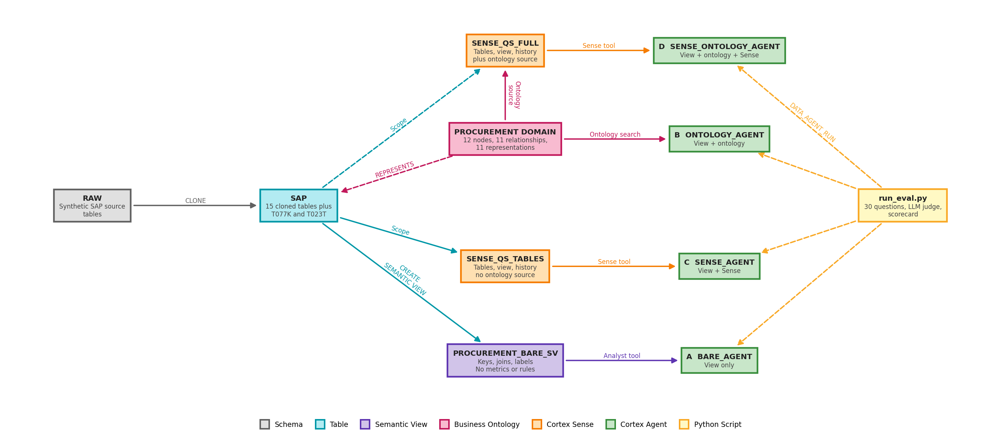
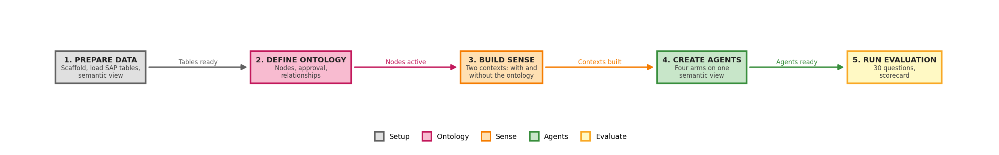

author: Chanin Nantasenamat, James Cha-Earley
id: getting-started-with-cortex-sense-and-business-ontology
categories: snowflake-site:taxonomy/solution-center/certification/quickstart, snowflake-site:taxonomy/product/ai, snowflake-site:taxonomy/product/platform
language: en
summary: Build a governed Business Ontology and two Cortex Sense contexts on SAP procurement data, then measure what each layer adds to a Cortex Agent with a 30-question evaluation.
environments: web
status: Published
feedback link: https://github.com/Snowflake-Labs/sfguides/issues

# Getting Started with Cortex Sense and Business Ontology

## Overview

Ask an AI agent "How many suppliers do we have?" and the answer depends on knowledge the agent was never given. The vendor master holds 15 vendor records, but procurement policy says one probationary vendor doesn't count, so the official answer is 14. Ask about storage capacity and the problem changes: the answer sits in a table that no semantic view covers, so a well-behaved agent says it can't find the data. A semantic view computes numbers correctly from the tables it covers, but it does not say which number is official, and it can't help with tables it does not include.

Two features fill those gaps from opposite directions. Business Ontology (currently in Private Preview, available to selected accounts) is a governed layer of business meaning: it records what each term means, which metric is canonical and which is only a look-alike, and which policies apply. A steward approves each definition once, and every agent that searches the ontology uses it. Cortex Sense (currently in Private Preview, available to selected accounts) builds context from your data estate itself: it indexes tables, semantic views and the queries people already run, and gives an agent a way to find the right tables and run SQL against them, even tables outside any semantic view. The ontology answers "what does this mean here", and Sense answers "where is this and how do I query it".

In this guide, you build both on a synthetic SAP procurement dataset and attach them to Cortex Agents in four combinations: the semantic view alone, plus the ontology, plus Sense, and plus both. You then run the same 30 questions against all four agents and read a scorecard that shows what each layer adds, where it adds nothing, and what the comparison can and cannot prove. Each step tells you what to run, shows a Cortex Code (CoCo) alternative where one exists, and ends with a check so you know it worked.

### What You'll Learn

- What belongs in a semantic view, in Business Ontology and in a Cortex Sense context
- How to model canonical metrics, their look-alikes and the policies that apply to them
- How to build a Cortex Sense context with and without an ontology source
- How to attach ontology search and a Sense context to a Cortex Agent
- How to measure what each layer adds with a fixed question set, and how to read the result honestly

Those are the skills. Here's the concrete result they produce.

### What You'll Build

The architecture below follows the data from the source tables to the four agents. The ontology and the two Sense contexts sit beside the semantic view, and an evaluation script asks every agent the same questions.



1. **Prepare the data.** Synthetic SAP tables load into a raw schema and are cloned into a working schema with two code tables.
2. **Describe the tables.** A bare semantic view covers the procurement tables with keys, joins and labels, but no metrics, synonyms or business rules.
3. **Govern the meaning.** One ontology domain holds 12 approved nodes, 11 relationships and 11 representations that tie meaning to the tables and the semantic view.
4. **Build context.** Two Sense contexts index the same schema. One also reads the ontology domain and the other does not.
5. **Compare agents.** Four agents share the semantic view and differ only in the extra tools they get. A script asks all four the same 30 questions and an LLM judge scores each answer.

The four agents, called arms in the scorecard, are set up as follows.

| Arm | Setup | What it adds |
|---|---|---|
| A | Semantic view | The bare `PROCUREMENT_BARE_SV`: tables, keys and joins, with no metrics, synonyms or business rules. |
| B | Semantic view + Business Ontology | Ontology search for governed definitions, such as official vs variant metrics and policies. |
| C | Semantic view + Cortex Sense | A Sense context without the ontology source, and its SQL tool, which can query tables outside the semantic view. Sense looks up context account-wide, so some ontology content can still appear. |
| D | Semantic view + Business Ontology + Cortex Sense | Ontology search plus a Sense context that includes the ontology source, so ontology content reaches the agent through two paths. |

By the end, your account holds the objects below.

| Object | Count | Notes |
|---|---|---|
| Source tables | 15 | In `SENSE_ONTOLOGY_QS.RAW`; six of them (`QUAL_MATRIX`, `BSEG`, `COEP`, `VBAP`, `KONV`, `T320`) are not in the semantic view |
| Working tables | 17 | The 15 clones plus the code tables `T077K` and `T023T` in `SENSE_ONTOLOGY_QS.SAP` |
| Semantic view | 1 | `PROCUREMENT_BARE_SV` |
| Ontology nodes | 12 | 5 entities, 5 metrics, 1 term, 1 policy |
| Relationships | 11 | Connect the nodes to each other |
| Representations | 11 | Connect nodes to tables and to the semantic view |
| Sense contexts | 2 | `SENSE_QS_TABLES` and `SENSE_QS_FULL` |
| Agents | 4 | `BARE_AGENT`, `ONTOLOGY_AGENT`, `SENSE_AGENT`, `SENSE_ONTOLOGY_AGENT` |

With the end result in mind, check that you have everything needed to build it.

### What You'll Need

- Access to a [Snowflake account](https://signup.snowflake.com/?utm_source=snowflake-devrel&utm_medium=developer-guides&utm_cta=developer-guides) where Business Ontology and Cortex Sense are both enabled. Both are in Private Preview, so ask your Snowflake account team if either is missing.
- A role that can create a database and a warehouse, create ontology domains, and hold `CREATE CONTACT` and `CREATE AGENT` on the working schema. The commands below use `ACCOUNTADMIN` for simplicity.
- Cortex Code (CoCo) with the `business-ontology` and `cortex-sense` skills. Both ship with CoCo, so there is nothing to install.
- A local terminal with Bash and Python 3.9 or later, plus the `snowflake-connector-python` package for the evaluation script.
- A Snowflake connection configured for the Python connector, for example in `~/.snowflake/connections.toml`.

> **Note:** a Snowflake CLI or Python connection that signs in through a browser can ask you to sign in again during a long evaluation run. If you see connection errors during the run, sign in again and use the `--resume` option shown in Step 6.

Everything you need is in place, so the next section sets up the working folder and the data.

## Setup

The workflow below shows the five stages you follow. The Setup section covers the first stage, and each remaining stage is one numbered step.



1. Prepare data
2. Define ontology
3. Build Sense
4. Create agents
5. Run evaluation

In this Setup section, you complete the first stage of the workflow: the working folder, the schemas and the semantic view.

### Create working directory

All SQL and the evaluation script come in one setup script, so you do not need to clone a repository. The script only writes local files; it runs no Snowflake statement.

Open the raw [setup_sense_ontology.sh](https://raw.githubusercontent.com/Snowflake-Labs/sfquickstarts/master/site/sfguides/src/getting-started-with-cortex-sense-and-business-ontology/src/setup_sense_ontology.sh) file and save it as `setup_sense_ontology.sh` in a local directory of your choice. Review it, then run the command below in that directory.

**Run this step:**

```bash
bash setup_sense_ontology.sh
```

**Expected after folder setup:** the script prints two lines and creates the `sense-ontology/getting-started` folder. A second run refuses to overwrite it.

```text
Created 11 project files in sense-ontology/getting-started.
No Snowflake statements or agent calls were executed.
```

The script's directory change does not persist in your terminal, so enter the new folder yourself.

```bash
cd sense-ontology/getting-started
pwd
```

**Expected:** the printed path ends in `/sense-ontology/getting-started`. Every local path in this guide is relative to that folder.

### Inspect project files

With the folder in place, review what it holds. The files are already on disk, so there is nothing to run here.

> **Note:** this section is a walkthrough. Review each file below (no action required); you run them in the steps that follow.

```text
sql/01_setup.sql             database, schemas and warehouse
sql/02_raw_data.sql          synthetic SAP source tables
sql/03_sap_schema.sql        clones, code tables and the bare semantic view
sql/04_domain.sql            the ontology domain
sql/05_nodes.sql             draft the 12 ontology nodes
sql/06_approve.sql           approve the drafts
sql/07_relationships.sql     connect nodes to each other
sql/08_representations.sql   connect nodes to tables and the view
sql/09_agents.sql            the four agents
eval/run_eval.py             the evaluation script
eval/questions.csv           the 30 questions with expected answers
```

Now that you know the layout, run the first three scripts to create the data.

### Load the data

Open `sql/01_setup.sql` in a Snowsight SQL worksheet and keep that one worksheet open for Steps 1 to 3, because the approval in Step 2 only sees drafts from its own session. Run the scripts in order: `01_setup.sql`, `02_raw_data.sql`, then `03_sap_schema.sql`.

**Run this step:** run all three scripts. `01_setup.sql` creates the `SENSE_ONTOLOGY_QS` database with `RAW` and `SAP` schemas and a `SENSE_ONTOLOGY_QS_WH` warehouse. `02_raw_data.sql` loads 15 synthetic SAP tables into `RAW`. `03_sap_schema.sql` clones them into `SAP`, adds the code tables `T077K` and `T023T`, and creates `PROCUREMENT_BARE_SV`.

**Expected after the three scripts:** `02_raw_data.sql` ends with a row-count table, and `03_sap_schema.sql` prints `cloned 15`.

```text
| cloned 15 |
```

With the data loaded, confirm the tables and the semantic view exist before building anything on top of them.

### Check the data

Run the following query. It compares the two vendor counts that the rest of the guide keeps returning to.

```sql
SELECT COUNT(*) AS vendor_records,
       COUNT_IF(k.EXCLUDE_FROM_ACTIVE_COUNT = FALSE) AS active_suppliers
FROM SENSE_ONTOLOGY_QS.SAP.LFA1 l
JOIN SENSE_ONTOLOGY_QS.SAP.T077K k ON l.KTOKK = k.KTOKK;
```

**Expected:** 15 vendor records and 14 active suppliers. Then run the two checks below.

```sql
SELECT COUNT(*) AS raw_tables FROM SENSE_ONTOLOGY_QS.INFORMATION_SCHEMA.TABLES WHERE TABLE_SCHEMA = 'RAW';
SELECT COUNT(*) AS sap_tables FROM SENSE_ONTOLOGY_QS.INFORMATION_SCHEMA.TABLES WHERE TABLE_SCHEMA = 'SAP' AND TABLE_TYPE = 'BASE TABLE';
SHOW SEMANTIC VIEWS IN SCHEMA SENSE_ONTOLOGY_QS.SAP;
```

**Expected:** `raw_tables` is 15, `sap_tables` is 17, and the semantic view list shows `PROCUREMENT_BARE_SV`.

The data and the bare semantic view are ready. The next step defines what the business words mean.

## 1. Create Domain

A domain is a container for one business area. It groups the nodes that area owns, where a node is any entry in the ontology: an entity, a metric, a term or a policy. This guide uses one domain, Sense Quickstart Procurement.

To create it, run `sql/04_domain.sql` in the same worksheet.

**Run this step:**

```sql
SELECT SYSTEM$CREATE_GLOSSARY_DOMAIN('Sense Quickstart Procurement', 'Governed procurement concepts for the Cortex Sense and Business Ontology quickstart: suppliers, purchase orders, shipments and carriers. Steward: Procurement data steward.');
```

**Expected after creating the domain:** the call returns `error` as `false` and the domain path.

```json
{
  "error": false,
  "domainId": "<generated-domain-id>",
  "name": "Sense Quickstart Procurement",
  "path": "Business Ontology > Sense Quickstart Procurement"
}
```

The domain exists but is empty. The next step fills it with nodes.

## 2. Add Nodes

Nodes are the ontology's building blocks. This domain has 5 entities (Supplier, Material, Purchase Order, Shipment, Carrier), 5 metrics, 1 term and 1 policy. Each metric states its canonical definition in plain language, and each look-alike is a separate node so an agent can tell them apart.

| Node | Kind | What it records |
|---|---|---|
| Supplier Count | Metric | The official count: vendors in account group ZSTR or ZSTD. Probationary vendors are excluded. |
| Vendor Record Count | Metric | A variant: every record in the vendor master, for data maintenance only. |
| On-Time Delivery Rate | Metric | The official rate: delivered shipments (status D) whose actual date is on or before the planned date. |
| Carrier Reported On-Time Rate | Metric | A variant: what carriers report about themselves. Not delivery performance. |
| Procurement Spend | Metric | Total net value of purchase order lines, across every supplier. |
| Vendor Account Group | Term | What the vendor codes ZSTR, ZSTD and ZPRB mean. |
| Probationary Vendor Exclusion | Policy | Probationary vendors are not active suppliers. |

Run the two scripts below in the same worksheet session, in order. `05_nodes.sql` creates the 12 nodes as drafts, and `06_approve.sql` approves every draft from the current session.

**Run this step:** run `sql/05_nodes.sql`, then `sql/06_approve.sql`.

```sql
SELECT SYSTEM$APPROVE_ALL_GLOSSARY_TERMS('[]', 'ACTIVE', '{"sessionId":"CURRENT_SESSION"}');
```

**Expected after approval:** the approval call reports 12 approved and none failed.

```json
{ "error": false, "approved": 12, "failed": 0, "skipped": 0, "truncated": false }
```

If you changed worksheet sessions between the two scripts, `CURRENT_SESSION` matches nothing. Approve by domain instead: `SELECT SYSTEM$APPROVE_ALL_GLOSSARY_TERMS('[]', 'ACTIVE', '{"domain":"Sense Quickstart Procurement"}');`

### Use CoCo

If you would rather describe the nodes in plain language, open the CoCo panel and paste a prompt like the one below. CoCo proposes the nodes for your review before it writes anything, and its wording will differ from the script, so the counts in this guide apply to the script path.

```
$business-ontology In the domain Sense Quickstart Procurement, define Supplier Count as the official
count of active suppliers (account groups ZSTR and ZSTD, excluding probationary ZPRB), and add
Vendor Record Count as a variant. Show me the proposed nodes before creating them.
```

All 12 nodes are active, but nothing connects them yet. The next step adds the relationships and the representations.

## 3. Connect Nodes

Relationships say how nodes relate to each other, for example that Supplier Count measures Supplier and has Vendor Record Count as a variant. Representations say where a node lives in your data, for example that Supplier is represented by the `LFA1` table. Neither copies any data.

Run the two scripts below in order.

**Run this step:** run `sql/07_relationships.sql` (11 relationships), then `sql/08_representations.sql` (11 representations).

**Expected after both scripts:** every call returns `"error": false`, and a relationship call looks like this.

```json
{ "error": false }
```

A call that reports success has not necessarily been saved, so confirm the totals by reading them back.

### Check the ontology

The query below reads the domain summary, which counts nodes, relationships and representations in one result.

```sql
SELECT d.value:name::STRING AS domain,
       d.value:termCount::INT AS nodes,
       d.value:relationshipCount::INT AS relationships,
       d.value:associationCount::INT AS representations,
       d.value:draftCount::INT AS drafts,
       PARSE_JSON(SYSTEM$GET_GLOSSARY_SUMMARY()):truncation:relationships::BOOLEAN AS counts_may_be_low
FROM TABLE(FLATTEN(INPUT => PARSE_JSON(SYSTEM$GET_GLOSSARY_SUMMARY()):domains)) d
WHERE d.value:name::STRING = 'Sense Quickstart Procurement';
```

**Expected:**

| DOMAIN | NODES | RELATIONSHIPS | REPRESENTATIONS | DRAFTS | COUNTS_MAY_BE_LOW |
|---|---|---|---|---|---|
| Sense Quickstart Procurement | 12 | 11 | 11 | 0 | false |

> **Note:** in an account that already holds many ontology domains, the summary can truncate its relationship and representation counts, and `COUNTS_MAY_BE_LOW` shows `true`. A lower number then does not mean items were lost. Read a node directly to confirm, for example `SELECT SYSTEM$GET_GLOSSARY_TERM_ASSETS('Sense Quickstart Procurement.Supplier');`, which lists the `LFA1` representation. Avoid the whole-graph function `SYSTEM$GET_GLOSSARY_GRAPH` for this check, because it truncates in the same way.

The ontology is complete. Next you build the Cortex Sense contexts that index the same data.

## 4. Build Sense

A Cortex Sense context indexes the objects you scope into it: tables, semantic views and the queries people already run in your account. You build two. `SENSE_QS_TABLES` scopes the tables and the semantic view only. `SENSE_QS_FULL` scopes the same objects and also reads the Sense Quickstart Procurement ontology domain. Comparing them shows what the ontology source adds to Sense.

Cortex Sense is set up through the `cortex-sense` skill. It scans your account, proposes a scope, waits for you to type `build`, shows a short description for you to accept, and then saves and starts the build. Use one prompt for each context. The setup asks for a notification contact, and `just me` is enough.

**Run this step:** paste the first prompt into CoCo and follow its questions. Repeat with the second prompt after the first context is saved.

```
$cortex-sense Set up a Cortex Sense context named SENSE_QS_TABLES. Store it in SENSE_ONTOLOGY_QS.SAP.
Scope: all tables in SENSE_ONTOLOGY_QS.SAP and the semantic view SENSE_ONTOLOGY_QS.SAP.PROCUREMENT_BARE_SV.
Do not include any Business Ontology domain. Build on warehouse SENSE_ONTOLOGY_QS_WH.
```

```
$cortex-sense Set up a Cortex Sense context named SENSE_QS_FULL. Store it in SENSE_ONTOLOGY_QS.SAP.
Scope: all tables in SENSE_ONTOLOGY_QS.SAP and the semantic view SENSE_ONTOLOGY_QS.SAP.PROCUREMENT_BARE_SV.
Also include the Business Ontology domain Sense Quickstart Procurement.
Build on warehouse SENSE_ONTOLOGY_QS_WH.
```

**Expected from CoCo (illustrative):** the skill shows a scope box like the one below and waits for you. Type `build` to accept it. The exact layout and object counts depend on your account.

```text
─── SENSE_QS_FULL · scope ────────────────────  proposed
  INCLUDE
    Tables           SENSE_ONTOLOGY_QS.SAP.*                  ~17
    Semantic Views   SENSE_ONTOLOGY_QS.SAP.PROCUREMENT_BARE_SV  1
    Ontology         Sense Quickstart Procurement
                       12 Nodes · 11 Relationships · 11 Associations
  build · include <pattern> · exclude <pattern> · deeper
```

Each build runs in the background. Do not wait for a fixed time; use the readiness check below instead.

### Check the contexts

Run the query below. A context that has not finished shows a `last_processed_at` of 1970, which the query reports as `building`.

```sql
SELECT c.value:name::STRING AS context,
       IFF(c.value:last_processed_at::STRING LIKE '1970%', 'building', 'processed') AS state
FROM TABLE(FLATTEN(INPUT => PARSE_JSON(SYSTEM$CORTEX_AGENT_CORTEX_CONTEXT_BUILDER('{"action":"list-contexts"}')):response_structured:cortex_contexts)) c
WHERE c.value:database_name::STRING = 'SENSE_ONTOLOGY_QS'
ORDER BY 1;
```

**Expected when both builds finish:**

| CONTEXT | STATE |
|---|---|
| SENSE_QS_FULL | processed |
| SENSE_QS_TABLES | processed |

> **Note:** across test runs, a context took anywhere from about 12 to about 50 minutes to reach `processed`, so rely on the check and not on a clock.

Both contexts are built. Next you create the four agents that use them.

## 5. Create Agents

All four agents use the same bare semantic view, so any difference in their answers comes from the extra tools. `sql/09_agents.sql` creates them with `CREATE OR REPLACE AGENT`. Review the part that differs: the tools and the tool resources.

> **Note:** this block is a walkthrough. Review it below (no action required); `sql/09_agents.sql` creates all four agents.

```yaml
tools:
  - tool_spec: {type: cortex_analyst_text_to_sql, name: query_procurement}
  - tool_spec: {type: snowscope_search, name: business_ontology}   # arms B and D
  - tool_spec: {type: cortex_sense, name: procurement_context}     # arms C and D
tool_resources:
  query_procurement: {semantic_view: SENSE_ONTOLOGY_QS.SAP.PROCUREMENT_BARE_SV}
  business_ontology: {corpus: businessOntology}                    # arms B and D
  procurement_context: {context_name: SENSE_ONTOLOGY_QS.SAP.SENSE_QS_FULL}   # arm D; arm C uses SENSE_QS_TABLES
```

- `query_procurement` runs text-to-SQL against the semantic view. Every arm has it.
- `business_ontology` searches approved ontology nodes before the agent queries data. Arms B and D have it.
- `procurement_context` retrieves Sense context and adds a SQL tool that can query any table the role can read. Arms C and D have it, which is why only they can reach tables outside the semantic view.

**Run this step:** run `sql/09_agents.sql`.

**Expected after the script:** four success messages.

```text
| Agent BARE_AGENT successfully created. |
| Agent ONTOLOGY_AGENT successfully created. |
| Agent SENSE_AGENT successfully created. |
| Agent SENSE_ONTOLOGY_AGENT successfully created. |
```

Before running 30 questions, ask one question directly to confirm the wiring.

### Check an agent

Ask arm C a question that only its Sense tool can answer, because storage locations are in no semantic view.

```sql
SELECT SNOWFLAKE.CORTEX.DATA_AGENT_RUN('SENSE_ONTOLOGY_QS.SAP.SENSE_AGENT',
  $${"messages":[{"role":"user","content":[{"type":"text","text":"How many storage locations belong to plant PLT-001?"}]}]}$$) AS response;
```

**Expected:** the response lists a call to `procurement_context` and then `system_execute_sql`, and the text answer says plant PLT-001 has 3 storage locations. An errored `procurement_context` result, or an answer with no SQL call, means the context name or its build state needs attention.

The agents work. Next you run the full evaluation.

## 6. Run Evaluation

The evaluation asks all four agents the same 30 questions, 10 in each category, and an LLM judge compares each answer with the expected value in `eval/questions.csv`. Expected values were computed from SQL against the data, not typed by hand.

| Category | Questions | What it tests |
|---|---|---|
| Governed | 10 | Answers that depend on an official definition or a policy, such as the official on-time rate |
| Discovery | 10 | Answers in tables that are in neither the semantic view nor the ontology |
| Control | 10 | Plain lookups every arm should answer from the semantic view |

Set up the Python environment and tell the script which connection and schema to use.

**Run this step:**

```bash
pip install snowflake-connector-python
export SNOWFLAKE_CONNECTION_NAME=<your-connection-name>
export SNOWFLAKE_WAREHOUSE=SENSE_ONTOLOGY_QS_WH
python eval/run_eval.py --reps 2
```

The script runs 240 agent calls (30 questions, 2 repetitions, 4 arms) and writes `eval/results.json`. A connection or service error is retried and is never scored as a wrong answer. If a run stops part way, add `--resume` to run only the calls that have no verdict yet.

**Expected after the run:** a scorecard like the one below. The numbers are from one run; yours will differ by a few answers because agents and the judge are not deterministic.

```text
Arm                         governed   discovery     control     total
A BARE_AGENT                   12/20        0/20       20/20     32/60
B ONTOLOGY_AGENT               20/20        0/20       20/20     40/60
C SENSE_AGENT                  14/20       20/20       20/20     54/60
D SENSE_ONTOLOGY_AGENT         20/20       20/20       20/20     60/60
```

The scorecard is the result, but reading it takes some care. The next step explains what it does and does not show.

## 7. Read Results

Read the scorecard one category at a time.

- **Governed questions:** arms B and D scored 20 of 20, while arms A and C scored 12 and 14 of 20. The ontology fixes the questions where an official definition differs from the obvious reading, such as the on-time delivery rate (66.7 percent official against the 90 percent the carriers report). Sense alone recovered some of these definitions but not reliably.
- **Discovery questions:** arms C and D answered all of them, while arms A and B answered none. The tables in these questions are outside the semantic view, and only the Sense tool brings an SQL tool that can reach them.
- **Control questions:** every arm scored 20 of 20. A drop here would mean an extra tool makes an agent worse at plain lookups.

Arm D scored 60 of 60 in this run, but a single run overstates how clean the result is. In an earlier run of the same design, arm D missed both storage-location questions: it called the Sense and ontology tools, never ran SQL, and answered that the data was not available, and it scored 56 of 60. Totals moved by a few answers between runs for every arm, so treat differences of one or two questions as noise.

Before you trust any number in the scorecard, keep these limits in mind.

- **The questions were written knowing which layer should win.** The categories test the hypotheses they were built around, so the margins are partly by design. Write questions from your own users' real queries to remove that bias.
- **Arms A and B cannot reach the discovery tables at all.** The semantic view covers a fixed set of tables, and only arms C and D get an SQL tool. A 0 in that category means "no access", not "poor reasoning".
- **Arm C is a partial isolation of Sense.** Sense looks up context across the whole account, so arm C can still see some ontology content.
- **The sample is small.** With 30 questions, only large differences are reliable. In a paired comparison by question, arm D beat arm A on 15 questions and lost none, and beat arm B on 10 and lost none. Arm D against arm C came out at 3 wins to 0 losses, which is too few to separate them, so this run does not show that adding the ontology to Sense helps beyond what Sense alone provides.
- **The judge is unchecked.** One LLM judge scored every arm. Hand-grade a sample before you rely on the totals.
- **Some answers open with a planning note.** Lines such as "Need full EKPO page for rules." sometimes appear at the start of an answer, in every arm. They did not stop most of those answers from being correct.
- **Repeating a question rarely changes the result.** Two repetitions gave the same verdict for almost every question and arm, so add questions rather than repetitions.

Together the results suggest that the two layers complement each other: the ontology supplies meaning, and Sense supplies reach. To go further, add more tables and questions, or change what the ontology covers.

## Going Further

You now have a working comparison. The ideas below extend it without changing the setup.

- **Add a question category.** Write 10 questions that need both an official definition and a table outside the semantic view. That is where the combination should matter most.
- **Add tables to Sense.** Clone more tables into `SENSE_ONTOLOGY_QS.SAP` and ask CoCo through the `cortex-sense` skill to reprocess a context so it picks them up.
- **Review the build report.** After a build, ask `$business-ontology` to review the Cortex Sense report against the domain. It proposes edits to existing nodes and lists concepts the ontology does not have yet.

Whether or not you extend the comparison, remove what you created when you are done so nothing keeps running in your account.

## Clean Up

Only remove resources this guide created. Sense contexts and ontology domains are account-level objects that survive `DROP DATABASE`, so remove them first.

**Run this step:** ask CoCo to delete the two contexts. Deleting a context is irreversible, so the skill asks you to type the context name to confirm.

```
$cortex-sense Delete the Cortex Sense contexts SENSE_QS_TABLES and SENSE_QS_FULL in SENSE_ONTOLOGY_QS.SAP.
```

**Expected:** each deletion reports `deleted` as `true`. Then empty the ontology domain. A domain can't be deleted while it holds nodes, including drafts.

```
$business-ontology Review and remove the contents of only the domain Sense Quickstart Procurement,
including representations, relationships, approved nodes and drafts. Show the exact targets and ask
for confirmation before deleting anything. Leave the empty domain for the SQL deletion step.
```

After the domain is empty, delete it as a role with `OWNERSHIP` on it.

```sql
SELECT SYSTEM$DELETE_GLOSSARY_DOMAIN('Sense Quickstart Procurement');
```

**Expected:** the response has `error` as `false` and `state` as `DELETED`. Finally, drop the database and the warehouse, which also removes the schemas, tables, semantic view and agents.

```sql
DROP DATABASE IF EXISTS SENSE_ONTOLOGY_QS;
DROP WAREHOUSE IF EXISTS SENSE_ONTOLOGY_QS_WH;
```

**Expected:** both statements succeed, and the database and warehouse no longer exist. Dropping the database does not remove the Sense contexts or the ontology domain, which is why they come first.

With the resources removed, here is a recap of what you built and where to go next.

## Conclusion And Resources

Congratulations! You've successfully built a governed Business Ontology and two Cortex Sense contexts on SAP procurement data, attached them to Cortex Agents in four combinations, and measured what each layer adds with a 30-question evaluation. The ontology decides which number is official, and Sense finds the tables the semantic view does not cover.

### What You Learned

- The ontology fixes questions where an official definition differs from the obvious reading, and Sense alone did not.
- Sense reaches tables outside any semantic view, and the ontology alone cannot.
- A fixed question set with expected answers computed from SQL turns "it feels better" into a scorecard.
- A comparison is only as honest as its caveats: who wrote the questions, which arms can reach which tables, and how large the sample is.

To keep exploring, these resources cover the underlying features in more depth.

### Related Resources

- [Snowflake Cortex Agents documentation](https://docs.snowflake.com/en/user-guide/snowflake-cortex/cortex-agents)
- [Semantic views overview](https://docs.snowflake.com/en/user-guide/views-semantic/overview)
- [Snowflake Developer Guides on GitHub](https://github.com/Snowflake-Labs/sfguides)
